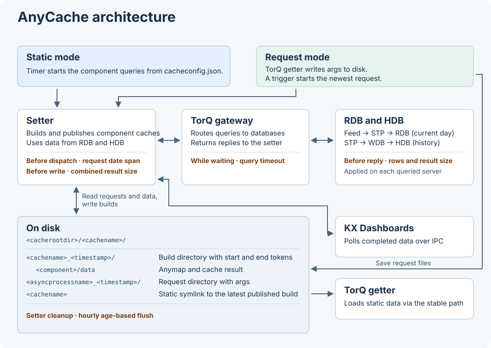
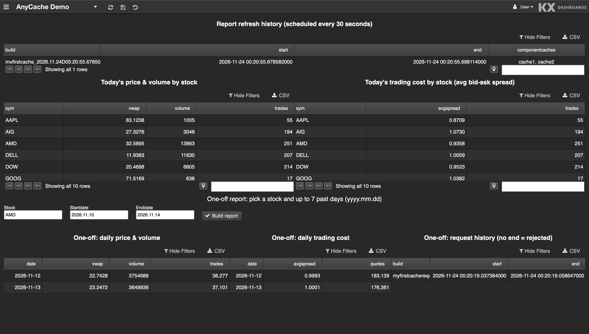

# Anycache System

## Overview

AnyCache is a caching system meant to be deployed alongside an existing kdb+/q setup. The inspiration came from a recurring client need for a caching system. AnyCache runs queries on a schedule (static mode) or on request (request mode), saves the results to disk, and lets any process or KX Dashboards read them.

## Architecture

Setter builds on a timer (when in static mode) or when triggered (when in request mode). Setter takes in configuration from the `cacheconfig.json`, and queries the gateway to get the data it builds its caches from. Every main cache can be made up of multiple component caches, which can be specified in the `cacheconfig.json`.



Each main build lives at `<cacherootdir>/<cachename>/<cachename>_<timestamp>/`. The main build and each component have `start` and `end` timestamp files. The setter writes the main `end` only after all components finish. Each component stores its result at `<component>/data`. Static mode provides the stable path through a symbolic link `<cacherootdir>/<cachename>/<cachename>`. Request input lives alongside builds in `<asyncprocessname>_<timestamp>`.

## Processes

| Process | Role in AnyCache |
| --- | --- |
| `setter` | Builds the caches and writes them to disk. Reads `cacheconfig.json`, sends its queries to the gateway, and serves the cache to the dashboard. Code: `code/processes/setter.q`. |
| `gateway` | Receives and runs setter's queries and returns the results. |
| TorQ processes | Loads `code/common/getter.q`, which allows it to read static builds and write cache requests. |
| KX Dashboard | A separate q process that connects to setter and polls its read API. |

## Design decisions

- **Dedicated setter.** The setter owns scheduling, validation, result assembly, persistence, and the read API. The gateway continues to own query dispatch to the existing database processes. Builds still use the estate’s gateway and database capacity, and the setter waits for replies during a build.
- **AnyMap on disk.** The setter writes component results using [`anymaputils.q`](../code/common/anymaputils.q). q readers open the data by its base filename. AnyMap can use companion files with `#` and `##` suffixes, so keep those files with the base file when copying or moving a snapshot. Request writers and filesystem readers need access to the corresponding cache directory.
- **Stable static path.** On Unix, the setter repoints the `<cachename>` symlink after completing a build and then removes older static builds. The getter can use the same path on every refresh. Consumers that need the exact build can use `latestcache[]` and its timestamped path while it is retained.
- **Limits at each stage.** Date checks keep oversized request ranges from reaching the gateway. Per-server row and size checks keep oversized results from crossing IPC. The gateway timeout bounds the wait for each server call, and the setter checks the combined size before persisting it. These checks still leave query execution and result assembly subject to the memory available in each process.

## Quick-Start Demo Install

To install, run `demosetup.sh`.

It pulls the TorQ Finance Starter Pack, then lays TorQ on top with the anycache system.

demosetup script:

```
mkdir "anycachedemo"
cd "anycachedemo"
git clone "https://github.com/DataIntellectTech/TorQ-Finance-Starter-Pack" "."
mkdir "temp"
cd "temp"
git clone -b "anycache" "https://github.com/bsofjan/TorQ.git" "."
cp -a "." ".."
cd ".."
rm -rf "temp"
rm -rf ".git"
```

Then in `setenv.sh` set `KDBX` to your KDB-X (5.0) binary and, if needed, `KDBBASEPORT`, and start everything:

```
./torq.sh start all
./torq.sh summary
```

`setter1` starts with the rest, on port `KDBBASEPORT+24`.

## Configuration for existing systems

Setter reads `cacheconfig.json`.

| Field | Default | Meaning |
| --- | --- | --- |
| `cacherootdir` | Required | Folder the caches are written to. |
| `cachename` | Required | Name of the cache, used for folder names. |
| `asyncprocessname` | Required | Folder prefix for cache requests. |
| `componentcaches.<name>.datasource` | Required | Where static mode queries run, eg `rdb` |
| `componentcaches.<name>.staticmode` | Required in static mode | Query run for that component cache in static mode. |
| `setter.mode` | Required | `request` for request mode, anything else (eg `static`) for static mode |
| `setter.interval` | Required | In static mode, the time between builds, eg `0D00:01`. |
| `setter.cachestokeep` | `3` | Request mode: builds and requests kept on disk |
| `setter.maxresultmb` | `1024` | Largest result a query can return from a server, and largest result saved, in MB |
| `setter.maxrows` | `10000000` | Most rows a query can return from a server. |
| `setter.querytimeout` | `0D00:01` | Longest a query can take before the gateway times it out, eg `0D00:01`, which is used if not set |
| `setter.maxdatespan` | `7` | Request mode: most days a query can cover |
| `setter.flushhours` | `24` | Hours a build or request is kept before the hourly flush deletes it |


Example `cacheconfig.json`:

```json
{ 
    "cacherootdir": "/path/to/anycachedata",
    "cachename": "myfirstcache",
    "asyncprocessname": "asynccache",
    "componentcaches":{ 
        "cache1": { 
            "analytic": "analytic1", 
            "datasource": "rdb",
            "staticmode": "select by sym from trade"
        }, 
        "cache2": { 
            "analytic": "analytic2", 
            "datasource": "rdb",
            "staticmode": "select by sym from quote"
        } 
    }, 
   "getter":{ 
    "interval": "0D00:05"
   },
   "setter":{ 
    "mode": "request", 
    "interval": "0D00:01",
    "cachestokeep": 3,
    "compression": "16 3 0",
    "maxresultmb": 1024,
    "maxrows": 10000000,
    "querytimeout": "0D00:01",
    "maxdatespan": 7,
    "flushhours": 24
   }
}
```

Pay extra care to the `cacherootdir` and `setter.mode` field in `cacheconfig.json` as you will need to update these.

You will need to create the following files:

1. `appconfig/passwords/accesslist.txt`

```
discovery:pass
feed:pass
iexfeed:pass
gateway:pass
hdb:pass
housekeeping:pass
kill:pass
monitor:pass
rdb:pass
reporter:pass
sort:pass
tickerplant:pass
wdb:pass
chainedtp:pass
sortworker:pass
metrics:pass
vwapsub:pass
dqc:pass
dqcdb:pass
dqe:pass
dqedb:pass
segmentedtickerplant:pass
filealerter:pass
admin:admin
idb:pass
setter:pass
```

If you have the file above, add the final line `setter:pass` to your existing file.

1. `appconfig/passwords/setter.txt`

```
setter:pass
```

1. `appconfig/settings/setter.q`

```
// Bespoke Setter config

\d .servers
enabled:1b
CONNECTIONS: `gateway		// Setter connects to processes
HOPENTIMEOUT:30000
```

1. `appconfig/process.csv`

```
host,port,proctype,procname,U,localtime,g,T,w,load,startwithall,extras,qcmd
localhost,{KDBBASEPORT}+1,discovery,discovery1,${TORQAPPHOME}/appconfig/passwords/accesslist.txt,1,0,,,${KDBCODE}/processes/discovery.q,1,,q
localhost,{KDBBASEPORT},segmentedtickerplant,stp1,${TORQAPPHOME}/appconfig/passwords/accesslist.txt,1,0,,,${KDBCODE}/processes/segmentedtickerplant.q,1,-schemafile ${TORQAPPHOME}/database.q -tplogdir ${KDBTPLOG},q
localhost,{KDBBASEPORT}+2,rdb,rdb1,${TORQAPPHOME}/appconfig/passwords/accesslist.txt,1,1,180,,${KDBCODE}/processes/rdb.q,1,,q
localhost,{KDBBASEPORT}+3,hdb,hdb1,${TORQAPPHOME}/appconfig/passwords/accesslist.txt,1,1,60,4000,${KDBHDB},1,,q
localhost,{KDBBASEPORT}+4,hdb,hdb2,${TORQAPPHOME}/appconfig/passwords/accesslist.txt,1,1,60,4000,${KDBHDB},1,,q
localhost,{KDBBASEPORT}+5,wdb,wdb1,${TORQAPPHOME}/appconfig/passwords/accesslist.txt,1,1,,,${KDBCODE}/processes/wdb.q,1,,q
localhost,{KDBBASEPORT}+6,sort,sort1,${TORQAPPHOME}/appconfig/passwords/accesslist.txt,1,1,,,${KDBCODE}/processes/wdb.q,1,-s -2 -parentproctype wdb,q
localhost,{KDBBASEPORT}+7,gateway,gateway1,${TORQAPPHOME}/appconfig/passwords/accesslist.txt,1,1,,4000,${KDBCODE}/processes/gateway.q,1,,q
localhost,{KDBBASEPORT}+8,kill,killtick,,1,0,,,${KDBCODE}/processes/kill.q,0,,q
localhost,{KDBBASEPORT}+9,monitor,monitor1,,1,0,,,${KDBCODE}/processes/monitor.q,1,,q
localhost,{KDBBASEPORT}+10,tickerlogreplay,tpreplay1,,1,0,,,${KDBCODE}/processes/tickerlogreplay.q,0,,q
localhost,{KDBBASEPORT}+11,housekeeping,housekeeping1,${TORQAPPHOME}/appconfig/passwords/accesslist.txt,1,0,,,${KDBCODE}/processes/housekeeping.q,1,,q
localhost,{KDBBASEPORT}+12,reporter,reporter1,${TORQAPPHOME}/appconfig/passwords/accesslist.txt,1,0,,,${KDBCODE}/processes/reporter.q,1,,q
localhost,{KDBBASEPORT}+13,filealerter,filealerter1,${TORQAPPHOME}/appconfig/passwords/accesslist.txt,1,1,,,${KDBCODE}/processes/filealerter.q,1,,q
localhost,{KDBBASEPORT}+14,feed,feed1,,1,0,,,${KDBAPPCODE}/tick/feed.q,1,,q
localhost,{KDBBASEPORT}+15,segmentedchainedtickerplant,sctp1,${TORQAPPHOME}/appconfig/passwords/accesslist.txt,1,0,,,${KDBCODE}/processes/segmentedtickerplant.q,1,-parentproctype segmentedtickerplant,q
localhost,{KDBBASEPORT}+16,sortworker,sortworker1,,1,1,,,${KDBCODE}/processes/wdb.q,1,-parentproctype wdb,q
localhost,{KDBBASEPORT}+17,sortworker,sortworker2,,1,1,,,${KDBCODE}/processes/wdb.q,1,-parentproctype wdb,q
localhost,{KDBBASEPORT}+18,metrics,metrics1,${TORQAPPHOME}/appconfig/passwords/accesslist.txt,1,1,,,${KDBAPPCODE}/processes/metrics.q,1,,q
localhost,{KDBBASEPORT}+19,iexfeed,iexfeed1,,1,0,,,${KDBAPPCODE}/processes/iexfeed.q,1,,q
localhost,{KDBBASEPORT}+20,dqc,dqc1,${TORQAPPHOME}/appconfig/passwords/accesslist.txt,1,1,,,${KDBCODE}/processes/dqc.q,1,-parentproctype dqcommon,q
localhost,{KDBBASEPORT}+21,dqcdb,dqcdb1,${TORQAPPHOME}/appconfig/passwords/accesslist.txt,1,1,60,4000,${KDBDQCDB},1,,q
localhost,{KDBBASEPORT}+22,dqe,dqe1,${TORQAPPHOME}/appconfig/passwords/accesslist.txt,1,1,,,${KDBCODE}/processes/dqe.q,1,-parentproctype dqcommon,q
localhost,{KDBBASEPORT}+23,dqedb,dqedb1,${TORQAPPHOME}/appconfig/passwords/accesslist.txt,1,1,60,4000,${KDBDQEDB},1,,q
localhost,{KDBBASEPORT}+24,setter,setter1,${TORQAPPHOME}/appconfig/passwords/accesslist.txt,1,0,,,${KDBCODE}/processes/setter.q,1,,q
```

If you have the file above, add the final setter line to your existing file.

Config is read when a process starts, so restart setter after a change:

```
./torq.sh stop setter1 && ./torq.sh start setter1
```

## Safety and limits

| Where | What is enforced |
| --- | --- |
| **Setter before dispatch** | Request queries must be qSQL `select` strings with date filter. The setter checks the number of dates against `maxdatespan`. |
| **RDB or HDB before reply** | The database evaluates the query, then checks the result against `maxrows` and `maxresultmb`. |
| **Gateway while waiting** | The gateway returns a timeout error if the queued or running call exceeds `querytimeout`. |
| **Setter before writing** | The setter combines server results and checks the combined size against `maxresultmb`. |

We can also manage workspace limits through TorQ’s process settings and monitor the gateway, database, and setter processes independently.

## Running setter

Both modes check every hour and delete caches and requests older than `flushhours`.

### Static mode

Set `"mode": "static"` and an `interval`. Every interval setter runs each component cache's `staticmode` query through the gateway and saves a new build. When the build completes, the `<cachename>` symlink moves to it and older builds are deleted.

Read the newest static cache build from any TorQ process. Each component cache is loaded into `.anycache.cache.<name>`:

```
q).anycache.getter.loadcaches[]
q).anycache.cache.cache1
sym | time                          price size stop cond ex side
----| ----------------------------------------------------------
AAPL| 2026.10.28D11:42:28.096582000 72.95 86   0         N  buy 
AIG | 2026.10.28D11:42:28.096582000 34.84 47   0    K    O  sell
AMD | 2026.10.28D11:42:27.296632000 33.26 9    0    N    N  sell
```

### Request mode

Set `"mode": "request"`. There is no timer: a user asks for a cache, then setter builds it when triggered.

1. From any TorQ process, write a request with one query per component cache. It is saved as an args file in an `<asyncprocessname>_<timestamp>` folder:

```sql
q)q1:"select from trade where date = 2026.10.28, sym=`AAPL"
q)q2:"select from quote where date = 2026.10.28, sym=`AAPL"
q).anycache.getter.requestnewcache `cache1`cache2!{enlist[`query]!enlist x} each (q1;q2)
`:<cacherootdir>/myfirstcache/asynccache_2026.10.28D09:35:57.161384000/args
```

1. Trigger the build on setter. It builds the newest request:

```
h:hopen `:setterhost:setterport:user:password;
(neg h)".anycache.setter.detectandwritecache[]"
```

Request queries must be a select or exec that filters on a date with `=` or `within`, covering at most `maxdatespan` days.  
Results over `maxresultmb` or `maxrows` are stopped on the rdb or hdb, before they are sent back through the gateway. Queries longer than `querytimeout` are timed out by the gateway. Only the last `cachestokeep` builds and requests are kept.

## APIs

Examples of APIs below with three mock trades and quotes. Paths start with your `cacherootdir`.

### Getter: any TorQ process

`.anycache.getter.loadcaches[]` loads the newest static build into `.anycache.cache.<name>`, one variable per component cache. Static mode only, as it reads through the `<cachename>` symlink.

```
q).anycache.getter.loadcaches[]
q).anycache.cache.cache2
sym  time                          bid   ask   bsize asize mode ex src  
------------------------------------------------------------------------
AAPL 2026.10.28D11:31:43.521507000 78.28 79.37 131   99    B    N  DB   
AIG  2026.10.28D11:31:43.521507000 33.24 34.85 41    77    A    O  GETGO
AMD  2026.10.28D11:31:40.321631000 33.84 35.02 100   72    Z    N  GETGO
```

`.anycache.getter.requestnewcache[args]` saves a cache request for request mode. `args` maps each component cache to a dictionary with its `query`. It returns the path of the saved args file.

```sql
q)q1:"select from trade where date = 2026.10.28, sym=`AAPL"
q)q2:"select from quote where date = 2026.10.28, sym=`AAPL"
q).anycache.getter.requestnewcache `cache1`cache2!{enlist[`query]!enlist x} each (q1;q2)
`:<cacherootdir>/myfirstcache/asynccache_2026.10.28D09:35:57.161384000/args
```

### Setter: on setter, or over IPC

`.anycache.setter.detectandwritecache[]` builds the caches now. In static mode it is what the timer runs. In request mode it builds the newest request. The setter's log shows each step:

```
q).anycache.setter.detectandwritecache[]
```

```
starting new main cache build <cacherootdir>/myfirstcache/myfirstcache_2026.10.28D09:42:28.548395000
component caches to build: cache1, cache2
requesting data for component cache cache1 from rdb
saving data for component cache cache1 to <cacherootdir>/myfirstcache/myfirstcache_2026.10.28D09:42:28.548395000/cache1/data
data save completed for component cache cache1
main cache build completed <cacherootdir>/myfirstcache/myfirstcache_2026.10.28D09:42:28.548395000
```

`.anycache.setter.getcache[name]` returns a component cache from the newest completed build.

```
q).anycache.setter.getcache[`cache2]
sym  time                          bid   ask   bsize asize mode ex src  
------------------------------------------------------------------------
AAPL 2026.10.28D11:42:28.496662000 72.65 73.42 48    80    B    N  GETGO
AIG  2026.10.28D11:42:27.696826000 34.54 35.08 97    49    Z    O  SUN  
AMD  2026.10.28D11:42:27.696826000 32.43 33.55 158   136   N    N  BARX
```

`.anycache.setter.cachebuilds[]` returns one row per build on disk, newest first. A build without an `end` time is still running or failed.

```
q).anycache.setter.cachebuilds[]
build                                      start                         end                           componentcaches 
-----------------------------------------------------------------------------------------------------------------------
myfirstcache_2026.10.28D09:42:28.548395000 2026.10.28D09:42:28.548419000 2026.10.28D09:42:28.578025000 "cache1, cache2"
```

`.anycache.setter.latestcache[]` returns the path of the newest completed build.

```
q).anycache.setter.latestcache[]
`:<cacherootdir>/myfirstcache/myfirstcache_2026.10.28D09:42:28.548395000
```

`.anycache.setter.flushcaches[]` deletes every build and request older than `flushhours`. Setter runs it every hour.

```
q).anycache.setter.flushcaches[]
```

## KX Dashboard

Setter exposes the newest completed cache build over IPC:

- `.anycache.setter.getcache[`cache1\]\` - data of a component cache from the newest completed build
- `.anycache.setter.cachebuilds[]` - one row per cache build on disk: name, start, end and component caches
- `.anycache.setter.latestcache[]` - path of the newest completed build

KX Dashboards connects to setter.

1. In KX Dashboards add a Connection to setter process.
2. Add a Query data source on that connection, set Subscription to Polling every few seconds, and point a Data Grid at it:

```
.anycache.setter.getcache[`cache1]
```

   Same for `cache2`.
3. Add a third data source for the cache builds and show it in a Data Grid:

```
.anycache.setter.cachebuilds[]
```

KX Dashboard showing Anycache system in operation


## Operations

Both modes check every hour and delete caches and requests older than `flushhours`.

| What you see | What to check |
| --- | --- |
| No builds or no static refresh | Check `./torq.sh summary`, the resolved config, gateway discovery, and the static `setter.interval`. In request mode, check that the request directory has `args` and that a trigger reached the setter. |
| Build has a start time and no end time | Check the setter log for the failing component, then check gateway and database logs for query errors, permissions, size or row limits, or timeouts. Verify available disk space and cache-directory permissions if the query succeeded. |
| Getter cannot load the static cache | Check that the stable path resolves to a completed build and all configured components contain readable AnyMap files. Compare the config loaded by reader and setter. |
| Dashboard has stale or missing data | Compare the setter port and `latestcache[]` with the last successful build in `cachebuilds[]`. Check the dashboard polling connection and the data grid query. |
| Old entries remain on disk | Check `flushhours` and the setter log. Both modes register hourly cleanup. Run `.anycache.setter.flushcaches[]` on the setter to apply it immediately. |

Config is read when a process starts, so restart setter after a change.

```bash
./torq.sh stop setter1 && ./torq.sh start setter1
```

Reload the config in TorQ readers and request writers as well.

## Future work

- **Make AnyCache a KDB-X module.** Setter and getter run inside TorQ today. As a KDB-X module, AnyCache could be loaded into any KDB-X process.
- **Accept functional selects as well as qsql.** Request queries must be qsql strings today. The main change is to make setter able to accept functional selects.
